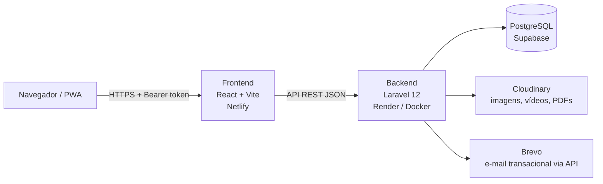

# 🧠 MindUp

**Plataforma web de apoio ao autocuidado emocional, com conteúdos publicados por psicólogos verificados.**

Trabalho de Conclusão de Curso — Tecnologia em Sistemas para Internet

## 📑 Sumário

- [Sobre o projeto](#-sobre-o-projeto)
- [Funcionalidades](#-funcionalidades)
- [Atores e permissões](#-atores-e-permissões)
- [Arquitetura](#-arquitetura)
- [Tecnologias](#-tecnologias)
- [Estrutura de pastas](#-estrutura-de-pastas)
- [Como rodar localmente](#-como-rodar-localmente)
- [Variáveis de ambiente](#-variáveis-de-ambiente)
- [Referência da API](#-referência-da-api)
- [Testes](#-testes)
- [Deploy](#-deploy)
- [Decisões de projeto](#-decisões-de-projeto)
- [Limitações conhecidas](#-limitações-conhecidas)
- [Trabalhos futuros](#-trabalhos-futuros)
- [Documentação complementar](#-documentação-complementar)
- [Autor](#-autor)

---

## 💡 Sobre o projeto

O **MindUp** conecta pessoas a conteúdos de autocuidado emocional (vídeos, artigos, sugestões culturais e materiais de autoajuda) publicados exclusivamente por **psicólogos cadastrados cujo CRP foi conferido por um administrador**.

A identidade do produto é a **curadoria unidirecional**: o MindUp **não é uma rede social**. Não há mensagens entre usuários e psicólogos, comentários ou avaliações públicas. Essa escolha é deliberada. Em um tema sensível como saúde mental, a garantia de que todo conteúdo vem de um profissional verificado vale mais do que ter mais uma funcionalidade (veja [Trabalhos futuros](#-trabalhos-futuros) para a justificativa do que foi adiado).

> ⚠️ **Aviso:** o MindUp é uma ferramenta de apoio e **não substitui atendimento psicológico ou médico**. Em situação de crise, ligue para o **CVV (188)** ou para o **SAMU (192)**. Essa nota fica sempre visível no rodapé do sistema.

---

## ✨ Funcionalidades

### Para todos os visitantes

- **Modo visitante** (`/visitante`): prévia pública com os 3 conteúdos mais recentes de cada tipo, sem login. Nenhum dado de psicólogo é exibido. Ao tentar ver mais, o visitante é convidado a se cadastrar.

### Para usuários cadastrados

- Cadastro com **confirmação de e-mail obrigatória** e recuperação de senha (links assinados, válidos por 60 minutos).
- Navegação por **vídeos, artigos (PDF), sugestões** (livro, filme, série etc.) e **autoajuda** (imagem ou vídeo), com filtro por categoria.
- **Favoritos** unificados: um único toggle para os 4 tipos de conteúdo, com tela própria e filtros por tipo e categoria.
- **Diário de anotações** pessoais, com campo opcional de **humor** (8 opções com emoji).
- **Exportação do diário em PDF** (lista inteira ou uma anotação), feita no navegador, sem enviar o texto a nenhum servidor.
- Perfil com foto, edição de dados e exclusão de conta.

### Para psicólogos

- Cadastro com **região e número do CRP + CPF** (validados no formato).
- Status de verificação: `pendente` → `aprovado` | `rejeitado`.
- Painel profissional com **CRUD dos próprios conteúdos** (vídeos, artigos, sugestões e autoajuda). O painel só libera a publicação para psicólogos **aprovados**.
- Consulta às categorias do sistema.

### Para administradores

- Painel `/admin/psicologos` com abas de pedidos e psicólogos, para **aprovar, rejeitar, revogar e reativar**, sempre com motivo quando for rejeição ou revogação.
- A cada decisão: o **CPF é apagado**, registram-se quem decidiu, quando e o motivo, as sessões do psicólogo são encerradas e um e-mail de resultado é enviado.

### Outros

- **PWA instalável** (manifesto e ícones configurados via `vite-plugin-pwa`).
- Acessibilidade: foco visível, navegação por teclado, modais com `role="dialog"`, tecla Esc, foco preso e respeito a `prefers-reduced-motion`.
- Layout responsivo com Tailwind CSS.

---

## 👥 Atores e permissões

| Ator              | Como é criado                          | Permissão (_ability_ do token)                       | O que acessa                                           |
| ----------------- | -------------------------------------- | ---------------------------------------------------- | ------------------------------------------------------ |
| **Visitante**     | não tem conta                          | nenhuma                                              | apenas `/visitante`                                    |
| **Usuário**       | cadastro público                       | login normal                                         | conteúdos, favoritos, anotações, perfil                |
| **Psicólogo**     | cadastro público (nasce `pendente`)    | `publicador`, **somente se** `crp_status = aprovado` | tudo do usuário + painel e CRUD dos próprios conteúdos |
| **Administrador** | promovido direto no banco (`is_admin`) | `admin`                                              | tudo + verificação de psicólogos                       |

Existe uma única tabela `usuarios`; o papel é definido pelos atributos `tipo` e `is_admin`.

---

## 🏗️ Arquitetura



- **SPA + API REST**: o frontend consome a API do Laravel; a autenticação é por **token Bearer** (Laravel Sanctum) com _abilities_.
- **Carregamento inicial único**: após o login, o frontend faz **uma só requisição** (`GET /bootstrap`) que traz categorias, conteúdos e favoritos. Isso resolveu um problema de concorrência no plano gratuito do Render.
- **Mídia alternável**: o disco é escolhido por `FILESYSTEM_DISK` (`public` em desenvolvimento, `cloudinary` em produção).

---

## 🛠️ Tecnologias

| Camada                        | Tecnologia                                                                                          |
| ----------------------------- | --------------------------------------------------------------------------------------------------- |
| **Frontend**                  | React 19, Vite 7, Tailwind CSS 4, React Router 7, Axios, Context API, lucide-react, vite-plugin-pwa |
| **Backend**                   | Laravel 12, PHP 8.3, Laravel Sanctum                                                                |
| **Banco de dados**            | PostgreSQL (Supabase, _Session Pooler_)                                                             |
| **Armazenamento**             | Cloudinary (produção) / disco local (desenvolvimento)                                               |
| **E-mail**                    | Brevo via API HTTPS (o Render gratuito bloqueia SMTP)                                               |
| **Testes**                    | Cypress (E2E), PHPUnit (unitários), Postman (API)                                                   |
| **Hospedagem**                | Render (backend, Docker) e Netlify (frontend)                                                       |
| **Ambiente local (opcional)** | Laravel Sail (Docker)                                                                               |

---

## 📂 Estrutura de pastas

### Backend (`backend/`)

```text
app/
├── Http/
│   ├── Controllers/api/      # Controllers da API (Auth, Admin, Vídeos, Favoritos, Visitante...)
│   ├── Requests/             # Validação (RegisterRequest, Store/Update de cada recurso)
│   └── Resources/            # Formato das respostas JSON (AutorResource, VideoResource...)
├── Mail/                     # E-mails: verificação, redefinição de senha, resultado da análise
├── Models/                   # User, Video, Artigo, Sugestao, Autoajuda, Categoria, Favorito, Anotacao
└── Support/Humores.php       # Lista única dos humores aceitos
database/
├── migrations/
└── seeders/CategoriaSeeder.php   # ~89 categorias fixas
routes/api.php                # Todas as rotas da API
tests/
├── Unit/                     # Testes PHPUnit
└── api/                      # Coleções Postman
Dockerfile                    # Imagem de produção (Render)
```

### Frontend (`frontend/`)

```text
src/
├── components/               # Layout, header, footer, RotaProtegida, RotaPsicologo, RotaAdmin
├── context/                  # Auth, Bootstrap, Vídeos, Artigos, Sugestões, Autoajuda, Favoritos, Anotações
├── pages/
│   ├── admin/                # PainelPsicologos
│   ├── anotacoes/            # CRUD do diário + ExportarAnotacoes
│   ├── dashboard/            # Painel e CRUD do psicólogo
│   ├── visitante/            # Prévia pública
│   └── ...                   # login, cadastro, perfil, vídeos, artigos, favoritos etc.
├── service/api.js            # Instância do Axios (token, timeouts, tratamento de 401)
└── utils/                    # crp.js, humores.js, senha.js...
cypress/e2e/                  # Testes ponta a ponta
```

---

## 🚀 Como rodar localmente

### Pré-requisitos

- **Node.js** 18 ou superior e **npm**
- **PHP** 8.2+ (o deploy usa 8.3) e **Composer**
- **PostgreSQL** (ou Docker, para usar o Laravel Sail)

### 1. Backend

```bash
cd backend

# Dependências
composer install

# Ambiente
cp .env.example .env
php artisan key:generate
```

Edite o `.env` (veja [Variáveis de ambiente](#-variáveis-de-ambiente)). Para rodar local, o mínimo é:

```env
DB_CONNECTION=pgsql
DB_HOST=127.0.0.1
DB_PORT=5432
DB_DATABASE=mindup
DB_USERNAME=seu_usuario
DB_PASSWORD=sua_senha

FILESYSTEM_DISK=public
MAIL_MAILER=log
FRONTEND_URL=http://localhost:5173
```

Depois:

```bash
# Cria as tabelas e popula as categorias
php artisan migrate --seed

# Link para servir arquivos enviados (disco "public")
php artisan storage:link

# Sobe a API em http://localhost:8000
php artisan serve
```

> 💡 **E-mails em desenvolvimento:** com `MAIL_MAILER=log`, nenhum e-mail é enviado. O link de confirmação de cadastro (e o de redefinição de senha) aparece em `storage/logs/laravel.log`. Copie-o de lá para confirmar a conta.

<details>
<summary><b>Alternativa: Laravel Sail (Docker)</b></summary>

O projeto inclui um `compose.yaml` com o Sail e um PostgreSQL 17. Nesse caso, no `.env` use `DB_HOST=pgsql`.

```bash
./vendor/bin/sail up -d
./vendor/bin/sail artisan migrate --seed
./vendor/bin/sail artisan storage:link
```

</details>

### 2. Frontend

```bash
cd frontend
npm install
```

Crie o arquivo `.env` na raiz do frontend apontando para a API (note o `/api` no final):

```env
VITE_API_URL=http://localhost:8000/api
```

```bash
npm run dev
```

A aplicação abre em `http://localhost:5173` (ou na porta indicada no terminal).

### 3. Criando um administrador

Não existe cadastro público de administrador, por segurança. Cadastre-se normalmente, confirme o e-mail e promova a conta direto no banco:

```sql
UPDATE usuarios SET is_admin = true WHERE email = 'seu@email.com';
```

Faça login de novo para o token receber a _ability_ `admin`. Em seguida, cadastre um psicólogo e aprove-o em `/admin/psicologos` para testar o fluxo de publicação.

---

## 🔐 Variáveis de ambiente

### Backend (`backend/.env`)

| Variável                                                                                    | Descrição                                                           | Local                   | Produção                      |
| ------------------------------------------------------------------------------------------- | ------------------------------------------------------------------- | ----------------------- | ----------------------------- |
| `APP_KEY`                                                                                   | Chave da aplicação (`php artisan key:generate`)                     | gerada                  | obrigatória                   |
| `APP_ENV` / `APP_DEBUG`                                                                     | Ambiente e depuração                                                | `local` / `true`        | `production` / `false`        |
| `APP_URL`                                                                                   | URL pública da API                                                  | `http://localhost:8000` | URL do Render                 |
| `DB_*`                                                                                      | Conexão com o PostgreSQL                                            | banco local             | Supabase (_Session Pooler_)   |
| `FILESYSTEM_DISK`                                                                           | Onde guardar uploads                                                | `public`                | `cloudinary`                  |
| `CLOUDINARY_CLOUD_NAME`, `CLOUDINARY_API_KEY`, `CLOUDINARY_API_SECRET`, `CLOUDINARY_SECURE` | Credenciais do Cloudinary                                           | opcional                | obrigatórias                  |
| `MAIL_MAILER`                                                                               | Driver de e-mail                                                    | `log`                   | `brevo`                       |
| `BREVO_API_KEY`                                                                             | Chave de **API** do Brevo (não é a chave SMTP)                      | —                       | obrigatória                   |
| `MAIL_FROM_ADDRESS` / `MAIL_FROM_NAME`                                                      | Remetente                                                           | opcional                | remetente verificado no Brevo |
| `FRONTEND_URL`                                                                              | URL do frontend (monta os links dos e-mails e os redirecionamentos) | `http://localhost:5173` | URL do Netlify                |

### Frontend (`frontend/.env`)

| Variável       | Descrição                         | Exemplo                     |
| -------------- | --------------------------------- | --------------------------- |
| `VITE_API_URL` | URL base da API, incluindo `/api` | `http://localhost:8000/api` |

> 🔒 **Nunca versione o `.env`.** Ele já está no `.gitignore` do backend. Se algum segredo tiver sido commitado por engano, gere uma nova chave no serviço correspondente.

---

## 📡 Referência da API

Base: `{VITE_API_URL}` (ex.: `http://localhost:8000/api`). Autenticação: `Authorization: Bearer <token>`.

### Públicas

| Método | Rota                        | Descrição                                         |
| ------ | --------------------------- | ------------------------------------------------- |
| `POST` | `/login`                    | Login. Retorna `token`, `abilities` e `user`      |
| `POST` | `/register`                 | Cadastro (usuário ou psicólogo)                   |
| `GET`  | `/visitante/conteudos`      | Prévia pública (3 itens por tipo, cache de 120 s) |
| `POST` | `/forgot-password`          | Solicita redefinição de senha                     |
| `POST` | `/reset-password`           | Redefine a senha                                  |
| `GET`  | `/email/verify/{id}/{hash}` | Confirma o e-mail (URL assinada)                  |
| `POST` | `/email/reenviar`           | Reenvia o e-mail de confirmação                   |

### Autenticadas (qualquer usuário logado)

| Método                      | Rota                                                              | Descrição                                                       |
| --------------------------- | ----------------------------------------------------------------- | --------------------------------------------------------------- |
| `GET`                       | `/me`                                                             | Usuário logado                                                  |
| `GET`                       | `/bootstrap`                                                      | Categorias, conteúdos e favoritos em uma única resposta         |
| `POST`                      | `/logout` · `/logout/all`                                         | Encerra a sessão atual ou todas                                 |
| `GET` `PUT` `DELETE`        | `/usuarios/{id}`                                                  | Ver, editar e excluir **a própria conta** (admin: qualquer uma) |
| `GET`                       | `/categorias` · `/categorias/{id}`                                | Categorias                                                      |
| `GET` `POST` `DELETE`       | `/favoritos` · `/favoritos/{id}`                                  | Listar, alternar (toggle) e remover favoritos                   |
| `GET` `POST` `PUT` `DELETE` | `/anotacoes` · `/anotacoes/{id}`                                  | CRUD do diário (só do próprio dono)                             |
| `GET`                       | `/videos` · `/artigos` · `/sugestoes` · `/autoajudas` (+ `/{id}`) | Leitura dos conteúdos                                           |

### Psicólogo aprovado ou admin (`ability: publicador` ou `admin`)

| Método         | Rota                                                                                          | Descrição                                              |
| -------------- | --------------------------------------------------------------------------------------------- | ------------------------------------------------------ |
| `GET`          | `/dashboard/videos` · `/dashboard/artigos` · `/dashboard/sugestoes` · `/dashboard/autoajudas` | Conteúdos do próprio autor                             |
| `POST`         | `/videos` · `/artigos` · `/sugestoes` · `/autoajudas`                                         | Criar conteúdo                                         |
| `PUT` `DELETE` | `/{recurso}/{id}`                                                                             | Editar ou excluir (só o autor; admin pode qualquer um) |

### Somente admin (`ability: admin`)

| Método  | Rota                               | Descrição                                                                         |
| ------- | ---------------------------------- | --------------------------------------------------------------------------------- |
| `GET`   | `/usuarios` · `POST /usuarios`     | Listar e criar usuários                                                           |
| `GET`   | `/admin/psicologos?status=&busca=` | Lista de psicólogos, com contadores por status                                    |
| `PATCH` | `/admin/psicologos/{id}/status`    | Aprovar, rejeitar, revogar ou reativar (`motivo` obrigatório ao rejeitar/revogar) |

> Uploads usam `multipart/form-data`. Para editar com arquivo, o frontend envia `POST` com o campo `_method=PUT` (_method spoofing_ do Laravel).

---

## 🧪 Testes

### Frontend: Cypress (E2E)

Os testes usam `cy.intercept` para simular a API, então **rodam sem backend, sem banco e sem e-mail**.

```bash
npm run dev           # em um terminal (o Cypress espera a porta 5174; veja abaixo)
npx cypress open      # modo interativo
npx cypress run       # modo headless
```

O `baseUrl` está configurado para `http://localhost:5174`. Se o Vite subir em outra porta, use:

```bash
CYPRESS_baseUrl=http://localhost:5173 npx cypress run
```

Specs em `cypress/e2e/`: cadastro, login, recuperação de senha, rotas protegidas, anotações, favoritos, dashboard do psicólogo, autor nos conteúdos, admin de psicólogos e modo visitante.

### Backend: PHPUnit

```bash
php artisan test
```

Os testes unitários (`tests/Unit/`) cobrem validação de CPF e do cadastro, transições de status do admin, `AutorResource` (garante que e-mail e CPF não vazam), humores, mailables e o model `User`. Os testes de `tests/Feature/` usam um banco PostgreSQL **separado** (`mindup_testing`) configurado no `phpunit.xml`; o `RefreshDatabase` apaga e recria as tabelas desse banco, por isso ele **nunca** deve ser o de desenvolvimento ou o de produção.

### Backend: coleções Postman

Em `tests/api/` há uma coleção por módulo (Autenticação, Usuários, Vídeos, Artigos, Sugestões, Autoajuda, Categorias, Favoritos e Anotações). Importe no Postman e aponte a variável de URL para a sua API.

### Plano de teste

O plano de teste (planilha) usa as técnicas de **Particionamento de Equivalência** e **Análise do Valor Limite**.

---

## ☁️ Deploy

O deploy é automático a cada _push_ no GitHub.

| Serviço  | Plataforma                          | Observações                                                                                                                                                            |
| -------- | ----------------------------------- | ---------------------------------------------------------------------------------------------------------------------------------------------------------------------- |
| Backend  | **Render** (Docker, plano gratuito) | O `Dockerfile` roda `php artisan migrate --force --seed` e depois `php artisan serve`. Usa `PHP_CLI_SERVER_WORKERS=4` e um `uploads.ini` com limites maiores de upload |
| Frontend | **Netlify** (plano gratuito)        | O arquivo `public/_redirects` (`/* /index.html 200`) faz o roteamento da SPA                                                                                           |
| Banco    | **Supabase** (PostgreSQL)           | Conexão via _Session Pooler_                                                                                                                                           |
| Mídia    | **Cloudinary**                      | `FILESYSTEM_DISK=cloudinary`                                                                                                                                           |
| E-mail   | **Brevo**                           | `MAIL_MAILER=brevo`                                                                                                                                                    |

No plano gratuito do Render, a API "dorme" após um período sem acesso, então a **primeira requisição pode demorar**. Por isso o `api.js` usa timeout de 20 s (120 s em uploads) e sinaliza erros de timeout com `error.foiTimeout`.

---

## 🧭 Decisões de projeto

- **Disco de arquivos configurável:** todo código que lida com arquivos usa `config('filesystems.default')`, nunca um disco fixo.
- **Favoritos polimórficos:** uma tabela `favoritos` aponta para qualquer um dos 4 tipos de conteúdo; `POST /favoritos` funciona como _toggle_.
- **Abilities congeladas no token:** por isso toda decisão do admin apaga os tokens do psicólogo, forçando novo login para conceder ou retirar a permissão de publicar.
- **Privacidade por padrão:** o CPF é guardado **criptografado** (`encrypted` cast) e **apagado** quando o admin decide. O `AutorResource` expõe só nome, foto e CRP, nunca e-mail. A rota pública do visitante usa formato próprio, sem dados de autor.
- **Cadastro sem escalonamento de privilégio:** o `RegisterRequest` não aceita `is_admin` nem `role`; o `crp_status` só é definido pelo servidor.
- **CORS aberto (`*`):** a autenticação é por token Bearer, sem cookies nem `credentials`, o que torna isso aceitável para este caso.
- **Funcionalidades isoladas e reversíveis:** recursos novos (visitante, exportação) entram em arquivos próprios, com poucos pontos de contato com o código existente.
- **Nomenclatura em português** no backend (`senha`, `humor`, `nome_consultorio`...). O model `User` implementa `getAuthPassword()` retornando `senha`.

---

## ⚠️ Limitações conhecidas

- A **aprovação de psicólogos é manual**: o Cadastro Nacional do CFP não tem API pública e a consulta usa reCAPTCHA. Isso não escala para muitos pedidos.
- O conteúdo de um psicólogo **revogado continua visível**, e um **administrador ainda pode publicar**.
- O CPF não é único e a auditoria guarda apenas a **última** decisão.
- O PDF dos artigos **não é protegido contra download**. Ele abre em nova aba ou é baixado, conforme o aparelho. Um leitor integrado (pdf.js) fica como evolução.
- A exportação de anotações usa a janela de impressão do navegador ("Salvar como PDF"); no iPhone a experiência é mais desajeitada. O arquivo gerado não tem senha e fica no dispositivo do usuário (o sistema avisa isso antes de gerar).
- O campo `ativo` existe nas tabelas de conteúdo, mas **não é usado** pelos controllers (não há rascunho/ocultação).
- Os testes automatizados ainda não cobrem todos os fluxos de ponta a ponta no backend (verificação de psicólogos, visitante e exportação).

---

## 🔮 Trabalhos futuros

Itens **adiados de propósito** (cada um tem documento próprio em `docs/`):

| Item                                                  | Por que foi adiado                                                                     |
| ----------------------------------------------------- | -------------------------------------------------------------------------------------- |
| **Mapa de consultórios** (Mapbox + geolocalização)    | Mostraria apenas psicólogos do próprio MindUp; é uma feature grande e fica para depois |
| **Rascunho / visibilidade de conteúdo**               | O campo `ativo` já existe; falta implementar o filtro nos controllers                  |
| **Comentários nos conteúdos**                         | Exigiria denúncia e moderação pelo admin, um módulo próprio                            |
| **Avaliação por nota (1–5)**                          | Risco de pressão e disputa entre psicólogos e de afastar usuários de conteúdo útil     |
| **Verificação automática do CRP**                     | Depende de API oficial que hoje não existe                                             |
| **Leitor de PDF integrado (pdf.js)**                  | Melhora a experiência no celular                                                       |
| **Download direto do PDF das anotações (ex.: jsPDF)** | Evita a janela de impressão                                                            |

**Argumento central:** comentários e avaliações de usuários não verificados enfraqueceriam a garantia criada pela verificação de psicólogos e exigiriam governança (moderação, regras de exibição). O MindUp é curadoria, não rede social.

---

## 📚 Documentação complementar

Na pasta `docs/` do repositório:

- `alteracoes-visitante-exportacao-artigo.md`: modo visitante, exportação de anotações e aviso do PDF (regras RN16–RN28, plano de teste e impacto nos diagramas)
- `problema-carregamento-inicial.md`: histórico do bug de concorrência que originou o `/bootstrap`
- `mapa-trabalhos-futuros.md`, `rascunho-visibilidade-conteudo.md`, `comentarios-trabalhos-futuros.md`, `avaliacoes-trabalhos-futuros.md`: ideias adiadas, com justificativa e desenho para retomada

Outros materiais do TCC: documentação da verificação de psicólogos (RN01–RN15), diagramas de casos de uso e de classes (UML), mapa do site, diagrama de arquitetura, matriz de rastreabilidade e plano de teste.

---

## 👤 Autor

**Érick Luis Capera Barneche**
Projeto desenvolvido para fins acadêmicos, como Trabalho de Conclusão de Curso em Tecnologia em Sistemas para Internet.

Instituição: Instituto Federal de Educação, Ciência e Tecnologia Sul-rio-grandense;
Orientador: Rafael Cunha Cardoso;
Link do deploy: https://mindup-e.netlify.app  
contato: erickbarneche.pl020@academico.ifsul.edu.br
